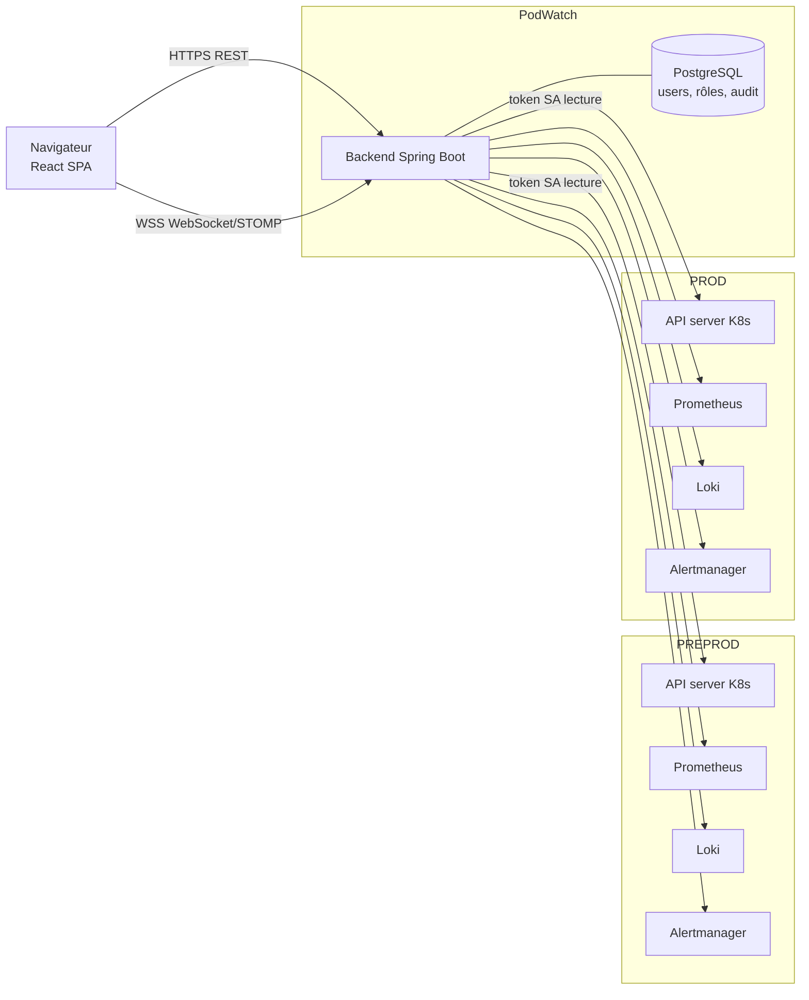

# ARCHITECTURE — PodWatch

> Statut : **proposition à valider** (Phase 0). Les points marqués 🟡 sont des décisions qui t'appartiennent.

---

## 1. Principes directeurs

1. **Simple d'abord** : un backend, un frontend, une base. Pas de microservices, de broker de messages ni de cache distribué tant qu'aucun besoin mesuré ne les justifie.
2. **Le backend est la seule porte vers l'infrastructure.** Le navigateur ne parle qu'à PodWatch. Les tokens K8s et les URL internes Prometheus/Loki ne sortent jamais du backend.
3. **Lecture seule par défaut.** Toute écriture (restart, delete, exec) est une exception explicite : permission, confirmation, audit.
4. **PROD est isolée.** Credentials, ServiceAccount et permissions distincts de ceux de PREPROD. Une erreur de configuration ne doit jamais faire « déborder » PREPROD sur PROD.
5. **Composants génériques** : les 17 types de ressources partagent le même modèle « liste + recherche + détail », côté backend comme côté frontend.

---

## 2. Vue d'ensemble



**Déploiement recommandé** 🟡 : PodWatch tourne dans un cluster (idéalement un cluster d'outillage, sinon PREPROD) et joint chaque API server via son endpoint. Pour le cluster qui l'héberge, il peut utiliser la config *in-cluster* ; pour les autres, un token de ServiceAccount et une CA.

*Alternative écartée* : un agent PodWatch par cluster qui remonte les données. C'est plus robuste aux contraintes réseau, mais beaucoup plus complexe (protocole agent, déploiement N fois). À reconsidérer seulement si le réseau interdit l'accès direct aux API servers (risque R7).

---

## 3. Backend

### 3.1 Style : monolithe modulaire

Un seul module Maven, avec un package par domaine. Chaque domaine expose une interface de service ; les autres domaines n'accèdent pas à ses classes internes. Si un jour on veut vérifier ces frontières automatiquement, ArchUnit (test JUnit) le fera sans changer d'architecture.

```
backend/src/main/java/io/podwatch/
├── PodWatchApplication.java
├── cluster/        # Registre multi-cluster, ApiClient par cluster, health-check, informers
├── resource/       # Lecture générique des ressources K8s (pods, deployments, …) → DTO
├── dashboard/      # Agrégations (compteurs, statuts) multi-cluster
├── logs/           # Logs à la demande, streaming WebSocket, export ; adaptateur Loki
├── events/         # Events K8s, flux temps réel
├── metrics/        # Adaptateur Prometheus, catalogue de requêtes PromQL
├── alerting/       # Détections internes + adaptateur Alertmanager
├── operations/     # Actions Run (restart, delete, exec) — protégées
├── security/       # Spring Security, utilisateurs, rôles, permissions par environnement
├── audit/          # Journal d'audit (qui, quoi, quel cluster, quand, résultat)
└── common/         # Erreurs (ProblemDetail), pagination, config, utilitaires
```

Chaque domaine suit le découpage classique Spring : `XxxController` (REST) → `XxxService` → adaptateur (client K8s, Prometheus…) ou `Repository` JPA. Les objets K8s (`V1Pod`, etc.) **ne sortent jamais d'un controller** : ils sont mappés en DTO (`record` Java), ce qui permet aussi de masquer les données sensibles.

### 3.2 Gestion multi-cluster

**Configuration** (typée via `@ConfigurationProperties`, validée au démarrage) :

```yaml
podwatch:
  clusters:
    - id: preprod-eu
      displayName: "PREPROD Europe"
      environment: PREPROD          # enum PREPROD | PROD
      apiServerUrl: https://preprod-api.example.internal:6443
      credentials:
        tokenFile: /var/run/podwatch/clusters/preprod-eu/token   # monté depuis un Secret K8s
        caFile:    /var/run/podwatch/clusters/preprod-eu/ca.crt
      prometheusUrl: http://prometheus.monitoring.svc:9090
      lokiUrl:       http://loki.monitoring.svc:3100
      alertmanagerUrl: http://alertmanager.monitoring.svc:9093
      operations:
        enabled: true               # actions Run autorisées sur ce cluster
    - id: prod-eu
      environment: PROD
      # ...
      operations:
        enabled: false              # PROD : désactivé par défaut
```

Pourquoi un fichier de configuration plutôt qu'un écran d'administration qui stocke les clusters en base ? Les credentials restent dans des Secrets K8s, gérés comme le reste de l'infra (Helm, GitOps), et non dans une base applicative. C'est plus simple et plus sûr. Un écran d'ajout de clusters pourra venir plus tard si le besoin apparaît.

**Composants** :

| Classe | Rôle |
|---|---|
| `ClusterProperties` | Configuration typée et validée |
| `ClusterRegistry` | Au démarrage, crée un `ApiClient` par cluster (timeouts, TLS). Fournit `client(clusterId)`. |
| `ClusterHealthChecker` | `@Scheduled` toutes les 30 s : appelle `/version` et `/readyz`, puis expose l'état `UP / DEGRADED / DOWN` avec la cause. |
| `InformerManager` | Un `SharedInformerFactory` par cluster pour pods, nodes, namespaces, deployments et events. Les lectures du dashboard se font dans le cache local, sans appel à l'API server. |

**Gestion des erreurs** : un cluster `DOWN` ne casse jamais la page. Les réponses multi-cluster sont partielles et signalent leurs manques, par exemple `{"data": [...], "unavailableClusters": ["prod-eu"]}`.

### 3.3 Droits Kubernetes du backend (principe du moindre privilège)

Un ServiceAccount `podwatch-reader` par cluster, lié à un `ClusterRole` en lecture :

```yaml
apiVersion: rbac.authorization.k8s.io/v1
kind: ClusterRole
metadata:
  name: podwatch-reader
rules:
  - apiGroups: ["", "apps", "batch", "networking.k8s.io", "autoscaling", "storage.k8s.io"]
    resources: ["pods", "pods/log", "nodes", "namespaces", "services", "endpoints", "events",
                "configmaps", "persistentvolumes", "persistentvolumeclaims",
                "deployments", "replicasets", "statefulsets", "daemonsets",
                "jobs", "cronjobs", "ingresses", "networkpolicies", "horizontalpodautoscalers"]
    verbs: ["get", "list", "watch"]
  # PAS de "secrets" : PodWatch n'en lit jamais le contenu.
```

Les actions Run utilisent un **second** ServiceAccount `podwatch-operator`, avec un Role limité aux namespaces autorisés : `pods` en `delete`, `deployments` en `patch` pour le rollout restart, plus tard `pods/exec` en `create`. Il n'est fourni que pour les clusters où `operations.enabled: true`.

> Masquage des Secrets : puisque le SA ne peut pas lire `secrets`, l'UI n'affiche que les **références** (nom du Secret, clé) présentes dans les specs de pods. Les ConfigMaps sont lisibles, mais leurs valeurs dont la clé ressemble à `password|token|key|secret` seront masquées par défaut.

### 3.4 API REST

- Préfixe `/api/v1`. Ressources adressées par cluster : `GET /api/v1/clusters/{clusterId}/namespaces/{ns}/pods?search=&status=&page=&size=`
- Vues agrégées : `GET /api/v1/dashboard?environment=PROD&namespace=…`
- Erreurs au format standard **RFC 9457 `ProblemDetail`** (natif dans Spring).
- Documentation OpenAPI générée (springdoc). 🟡 C'est une dépendance supplémentaire, mais elle sert directement au testeur et au frontend.

### 3.5 Temps réel (WebSocket)

- **Spring WebSocket + STOMP** (natif Spring, pas de techno supplémentaire).
- Destinations :
  - `/topic/clusters/{id}/events` : events K8s poussés depuis les informers
  - `/user/queue/logs/{sessionId}` : flux de logs d'un container (propre à l'utilisateur)
- Streaming des logs : le backend ouvre `readNamespacedPodLog(follow=true)` (option `previous=true` disponible) dans un thread virtuel Java et pousse les lignes **par lots** (toutes les 200 ms) pour ne pas saturer le navigateur.
- Garde-fous : 5 flux maximum par utilisateur, fermeture à la déconnexion, timeout d'inactivité, contrôle d'autorisation **à l'abonnement** (pas seulement à la connexion).

### 3.6 Observabilité externe

| Source | Accès | Règle |
|---|---|---|
| Prometheus | API HTTP `/api/v1/query` et `/query_range` via `RestClient` | Le frontend demande une **métrique nommée** (`pod_cpu`, `namespace_memory`…). Le backend la traduit avec un catalogue de requêtes PromQL configurable. **Jamais de PromQL libre envoyé par le navigateur.** |
| Loki | API HTTP `/loki/api/v1/query_range` | Même principe : filtres structurés traduits en LogQL côté backend, labels échappés. |
| Alertmanager | API v2 `/api/v2/alerts` | Lecture des alertes actives et affichage. Silences : plus tard, et réservés aux rôles adaptés. |
| Grafana | Liens profonds | PodWatch n'embarque pas Grafana. Il propose des liens « ouvrir dans Grafana » vers les dashboards existants. |

**Alerting interne** (sans Prometheus) : CrashLoopBackOff, ImagePullBackOff, Node NotReady, Deployment indisponible, échec de Job et redémarrages anormaux sont **détectables directement depuis l'état K8s** (informers). On peut donc livrer ces détections avant l'intégration Prometheus. CPU saturé, mémoire élevée et PVC presque plein nécessitent Prometheus.

### 3.7 Persistance

**PostgreSQL est nécessaire** pour les utilisateurs, les rôles et permissions, le journal d'audit, puis les runbooks. Les données Kubernetes **ne sont pas stockées** : elles restent dans le cache des informers.

- Spring Data JPA, avec un schéma versionné par **Flyway**. 🟡 C'est un ajout à la stack imposée, justifié par le besoin de migrations reproductibles et testables. Alternative : Liquibase.
- Tests avec **Testcontainers PostgreSQL**.

Modèle initial :

```
app_user(id, username, display_name, password_hash?, enabled, created_at)
role(id, code)                       -- ADMIN, DEVOPS, READONLY
user_role(user_id, role_id, environment)   -- un rôle PAR environnement
audit_event(id, at, username, environment, cluster_id, action, target, outcome, details_json)
```

La table `user_role` porte l'environnement : un même utilisateur peut être `DEVOPS` en PREPROD et `READONLY` en PROD. C'est la séparation stricte demandée.

### 3.8 Sécurité applicative

| Sujet | Proposition |
|---|---|
| Authentification 🟡 | **Option A (recommandée si tu as un IdP)** : OIDC (Keycloak, Entra ID…) via `spring-boot-starter-oauth2-client`, avec les rôles mappés depuis les groupes. **Option B** : comptes locaux en base (BCrypt) gérés par un Admin. |
| Session | Cookie de session HttpOnly, Secure, SameSite=Lax, avec protection CSRF. Plus simple et plus sûr qu'un JWT stocké dans le navigateur pour une SPA servie sur le même domaine. |
| Autorisation | `@PreAuthorize("@perm.can(authentication, 'POD_DELETE', #clusterId)")` : un bean central `PermissionEvaluator` qui croise rôle × environnement du cluster. |
| Matrice par défaut | **READONLY** : lecture de tout sauf exec. **DEVOPS** : lecture plus restart/delete en PREPROD ; en PROD, seulement si le cluster l'autorise et avec confirmation renforcée. **ADMIN** : tout, plus la gestion des utilisateurs. **Exec** : désactivé partout tant que tu ne l'as pas activé. |
| Confirmation des actions | L'API exige un `confirmationToken`. Le frontend l'obtient via un premier appel qui décrit l'impact ; en PROD, l'utilisateur doit en plus ressaisir le nom de la ressource. |
| Audit | Aspect ou intercepteur sur la couche `operations` et sur les connexions/accès refusés. Le journal est en ajout seul (pas d'UPDATE ni de DELETE exposé). |
| En-têtes | CSP stricte, HSTS, X-Content-Type-Options, frame-ancestors none. |

---

## 4. Frontend

```
frontend/src/
├── app/            # Routing, layout, providers
├── api/            # Client REST typé, client STOMP
├── features/
│   ├── dashboard/
│   ├── resources/  # Vue générique liste/détail + config par type de ressource
│   ├── pods/
│   ├── logs/
│   ├── metrics/
│   ├── alerts/
│   └── admin/
├── components/     # Composants partagés (StatusBadge, ClusterSelector, ConfirmDialog…)
└── hooks/
```

| Besoin | Choix proposé | Pourquoi |
|---|---|---|
| Langage | **TypeScript** | Typage des DTO, refactorings sûrs |
| Build | **Vite** | Standard actuel |
| Routage | React Router | Standard |
| Données serveur | **TanStack Query** | Cache, polling et invalidation sans Redux. Remplace 90 % du state global. |
| WebSocket | `@stomp/stompjs` | Client STOMP standard, compatible avec Spring |
| Tests | **Vitest + Testing Library** | Natif Vite |
| Terminal exec (plus tard) | xterm.js | Standard de fait |

### 4.1 ✅ Bibliothèque UI — **Ant Design** (ADR-007)

| Option | + | − |
|---|---|---|
| **Ant Design** | Tables très riches (tri, filtres, pagination), pensée pour les back-offices et consoles d'admin | Style « Ant » marqué, bundle plus lourd |
| **Mantine** | Moderne, légère, très bonne DX, mode sombre simple | Tables basiques : il faut ajouter TanStack Table |
| **MUI** | Très répandue, très documentée | DataGrid avancée en partie payante |

**Recommandation : Ant Design**, parce que PodWatch est avant tout une console riche en tableaux.

### 4.2 ✅ Bibliothèque de graphiques — **ECharts** (ADR-007)

| Option | + | − |
|---|---|---|
| **Apache ECharts** (`echarts-for-react`) | Très performant sur les séries temporelles longues (milliers de points), zoom natif | API impérative, moins « React » |
| **Recharts** | Très simple, composants React | Ralentit sur les gros volumes |

**Recommandation : ECharts**, parce que l'historique Prometheus produit beaucoup de points.

---

## 5. Organisation du repository

```
PodWatch/
├── backend/                 # Spring Boot (Maven, mvnw)
├── frontend/                # React + Vite
├── helm/podwatch/           # Chart Helm de PodWatch
├── infrastructure/
│   ├── k8s-rbac/            # ClusterRole / SA podwatch-reader & operator, par cluster
│   └── local/               # kind/k3d + stack d'observabilité locale de dev
├── tests/                   # Tests e2e / smoke (hors tests unitaires, qui restent dans chaque module)
├── docs/                    # AUDIT, ARCHITECTURE, PLAN, ROADMAP, BACKLOG, TEST_*, ADR/
├── .github/workflows/
├── docker-compose.yml       # Dev local : PostgreSQL (+ backend/frontend)
├── README.md
└── CHANGELOG.md
```

✅ **Packaging — décidé : image unique (ADR-008).** Options étudiées : soit deux images (`podwatch-backend` et `podwatch-frontend` avec Nginx), soit **une seule image** où le build React est copié dans `static/` du jar Spring Boot. Je recommande **une seule image** : un seul déploiement, pas de CORS, cookie de session simple. Le frontend reste un projet séparé dans le repo ; il est simplement assemblé au build.

---

## 6. Environnement de développement local

- `docker compose up` : PostgreSQL.
- `kind` ou `k3d` : un cluster local qui joue le rôle de « PREPROD » (et un second pour simuler « PROD »).
- Backend lancé par `./mvnw spring-boot:run` avec le profil `local`.
- Frontend lancé par `npm run dev` (proxy Vite vers le backend).

Tout sera documenté pas à pas dans le `README.md` en Phase 1.

---

## 7. Stratégie de tests (résumé)

Le détail sera dans `TEST_PLAN.md`, rédigé par le rôle QA.

| Niveau | Outils | Cible |
|---|---|---|
| Unitaire backend | JUnit 5, Mockito, AssertJ | Services, mappers, permissions |
| Slice | `@WebMvcTest`, `@DataJpaTest` | Controllers, sécurité, repositories |
| Intégration | Testcontainers (PostgreSQL, **k3s**) | Vrai API server K8s, informers, logs |
| Frontend | Vitest, Testing Library | Composants, hooks |
| E2E / smoke | Playwright 🟡 (ajout à valider), ou simples tests HTTP | Parcours critiques après déploiement |

---

## 8. Décisions d'architecture à valider (ADR)

| ADR | Sujet | Proposition / décision |
|---|---|---|
| ADR-001 | Style | Monolithe modulaire Spring Boot |
| ADR-002 | Client K8s | `io.kubernetes:client-java` (officiel) + informers — ✅ **validé** |
| ADR-003 | Connexion multi-cluster | Backend central, SA en lecture seule par cluster, credentials en Secrets K8s |
| ADR-004 | Temps réel | WebSocket STOMP |
| ADR-005 | Persistance | PostgreSQL + JPA + Flyway |
| ADR-006 | Authentification | OIDC si un IdP existe, sinon comptes locaux ; session par cookie |
| ADR-007 | Frontend | React + TS + Vite + TanStack Query + Ant Design + ECharts — ✅ **validé** |
| ADR-008 | Packaging | Image Docker unique — ✅ **validé** |
| ADR-009 | Observabilité | Catalogue de requêtes côté backend, jamais de PromQL/LogQL libre |

Chaque ADR validé sera écrit dans `docs/adr/NNN-titre.md` (contexte, décision, conséquences).
