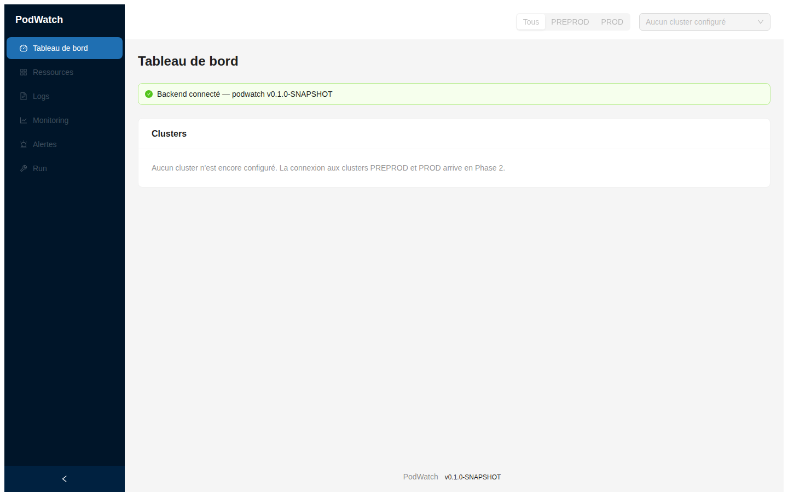

# Onboarding développeur — PodWatch

Bienvenue ! Ce guide t'amène d'un poste vierge à PodWatch qui tourne en local, sous **macOS** ou **Windows**.
Compte environ 30 à 45 minutes (essentiellement des téléchargements).

> Lis ensuite, dans cet ordre : [`ARCHITECTURE.md`](ARCHITECTURE.md) → [`ROADMAP.md`](ROADMAP.md) → [`BACKLOG.md`](BACKLOG.md) → [`CONTRIBUTING.md`](CONTRIBUTING.md).

---

## 1. Ce que tu vas installer

| Outil | Version | Pourquoi |
|---|---|---|
| Git | récente | Cloner et contribuer |
| JDK Eclipse Temurin | **25** (LTS) | Compiler et lancer le backend Spring Boot |
| Node.js | **26** (LTS) | Builder et lancer le frontend React (npm est inclus) |
| Docker Desktop | récente | PostgreSQL local, tests d'intégration (Testcontainers), image PodWatch |
| IDE | au choix | IntelliJ IDEA (backend) et/ou VS Code (frontend) |

**Maven n'est pas à installer** : le projet fournit le Maven Wrapper (`mvnw` / `mvnw.cmd`), qui télécharge automatiquement la bonne version de Maven.

---

## 2. Installation sous macOS (Homebrew)

### 2.1 Homebrew
Si `brew --version` ne répond pas, installe Homebrew en suivant https://brew.sh (une seule commande à copier dans le Terminal), puis :
```bash
brew update
```

### 2.2 Outils
```bash
brew install git
brew install --cask temurin@25          # JDK 25
brew install node                       # Node.js (vérifier ci-dessous que c'est bien la v26)
brew install --cask docker-desktop      # Docker Desktop
brew install --cask visual-studio-code  # optionnel
```
Ouvre ensuite **Docker Desktop** une première fois (Applications) et attends que la baleine indique « Docker Desktop is running ».

> Si `node -v` n'affiche pas `v26.x`, installe plutôt la version figée : `brew install node@26` puis suis l'instruction `echo 'export PATH=...' >> ~/.zshrc` affichée par Homebrew.

### 2.3 JAVA_HOME (recommandé pour les IDE et outils de build)
```bash
echo 'export JAVA_HOME=$(/usr/libexec/java_home -v 25)' >> ~/.zshrc
source ~/.zshrc
```

---

## 3. Installation sous Windows 10/11 (winget)

Toutes les commandes se lancent dans **PowerShell** (Windows Terminal recommandé). `winget` est fourni avec Windows 11 et les Windows 10 à jour.

### 3.1 Prérequis Docker : WSL 2
Dans PowerShell **en administrateur** :
```powershell
wsl --install
```
Redémarre la machine si c'est demandé.

### 3.2 Outils
PowerShell normal (non administrateur) :
```powershell
winget install --id Git.Git -e
winget install --id EclipseAdoptium.Temurin.25.JDK -e
winget install --id OpenJS.NodeJS.LTS -e
winget install --id Docker.DockerDesktop -e
winget install --id Microsoft.VisualStudioCode -e   # optionnel
```
**Ferme et rouvre le terminal** pour que le `PATH` soit pris en compte. Lance **Docker Desktop** et attends « Docker Desktop is running » (moteur WSL 2).

### 3.3 Points d'attention Windows
- **JAVA_HOME** : l'installeur Temurin propose l'option « Set JAVA_HOME variable » ; coche-la. Sinon, en administrateur :
  ```powershell
  setx JAVA_HOME "C:\Program Files\Eclipse Adoptium\jdk-25<version exacte>-hotspot" /M
  ```
- **Scripts npm bloqués** (« l'exécution de scripts est désactivée sur ce système ») :
  ```powershell
  Set-ExecutionPolicy -Scope CurrentUser RemoteSigned
  ```
- **Fins de ligne** : le repo force les fins de ligne via `.gitattributes`. Ne modifie pas `core.autocrlf` pour ce projet.
- **Maven** : utilise `.\mvnw.cmd` à la place de `./mvnw` dans toutes les commandes de ce guide.

---

## 4. Vérifier l'installation (macOS et Windows)

```bash
git --version
java -version          # doit afficher 25.x (Temurin)
node -v                # doit afficher v26.x
npm -v
docker version         # les sections Client ET Server doivent apparaître
docker compose version
```

---

## 5. Récupérer le projet

```bash
git clone https://github.com/sleepy-clemzer/PodWatch.git
cd PodWatch
```

---

## 6. Lancer PodWatch en local

### Option A — tout en une commande (pour « voir » l'application)
```bash
docker compose --profile app up --build
```
Ouvre http://localhost:8080. Arrêt : `Ctrl+C`, puis `docker compose --profile app down`.

### Option B — mode développement (pour coder)
Trois terminaux :

**Terminal 1 — base de données**
```bash
docker compose up -d postgres
docker compose ps            # postgres doit être "healthy"
```

**Terminal 2 — backend** (http://localhost:8080)
```bash
cd backend
./mvnw spring-boot:run -Dspring-boot.run.profiles=local        # macOS
.\mvnw.cmd spring-boot:run "-Dspring-boot.run.profiles=local"  # Windows (PowerShell)
```

**Terminal 3 — frontend** (http://localhost:5173, rechargement à chaud)
```bash
cd frontend
npm ci
npm run dev
```

Ouvre **http://localhost:5173** : le tableau de bord doit afficher « Backend connecté — podwatch v… ».

### Ce que tu dois voir


---

## 7. Lancer les tests

| Où | Commande | Remarque |
|---|---|---|
| backend | `./mvnw test` | Tests unitaires et tranches Spring (rapide) |
| backend | `./mvnw verify` | + tests d'intégration Testcontainers — **Docker Desktop doit tourner** |
| frontend | `npm test` | Vitest |
| frontend | `npm run lint` · `npm run typecheck` | Analyse statique, exécutée aussi en CI |

---

## 8. Configurer son IDE

**IntelliJ IDEA**
1. *File → Open* → sélectionner `backend/pom.xml` → *Open as Project*.
2. *File → Project Structure → SDK* : Temurin 25.
3. Lancer `PodWatchApplication` avec le profil `local` (*Run configuration → Active profiles : `local`*).

**VS Code** (frontend)
- Ouvrir le dossier `frontend/`. Extensions conseillées : ESLint, Prettier.

---

## 9. Problèmes fréquents

| Symptôme | Cause probable | Solution |
|---|---|---|
| `Connection refused` sur 5432 au démarrage du backend | PostgreSQL non démarré | `docker compose up -d postgres` |
| Tests `*IT` en échec « Could not find a valid Docker environment » | Docker Desktop arrêté | Démarrer Docker Desktop |
| `port 8080 already in use` | Autre application sur le port | Arrêter l'autre application, ou `docker compose --profile app down` |
| Le frontend affiche « Backend injoignable » | Backend non démarré ou en erreur | Regarder le terminal 2 ; tester `curl http://localhost:8080/actuator/health` |
| `./mvnw: Permission denied` (macOS) | Bit exécutable perdu | `chmod +x backend/mvnw` |
| `java -version` affiche une autre version | Plusieurs JDK installés | macOS : `JAVA_HOME` (§2.3) ; Windows : ordre du `PATH` / `JAVA_HOME` |

---

## 10. Ta première contribution

1. Choisir une user story `TODO` dans [`BACKLOG.md`](BACKLOG.md).
2. `git checkout -b feature/PW-<id>-<slug>`
3. Coder + tester, puis `git push` et ouvrir une Pull Request (le modèle se remplit automatiquement).
4. Attendre la CI verte et la revue. Détails : [`CONTRIBUTING.md`](CONTRIBUTING.md).
