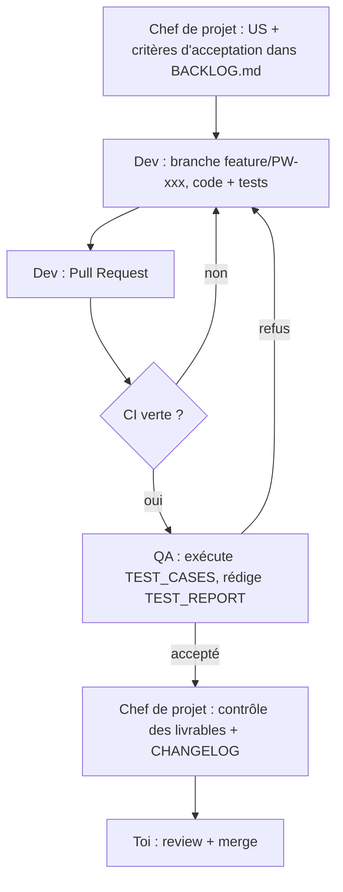

# PROJECT PLAN — PodWatch

> Responsable : rôle **Chef de projet**. Statut : **proposition à valider**.

## 1. Vision

Une console web centralisée, sécurisée et auditée pour superviser et exploiter les clusters Kubernetes PREPROD et PROD. C'est l'équivalent web et multi-utilisateurs d'OpenLens/Freelens, enrichi de Prometheus, Loki, Alertmanager, d'un RBAC par environnement et d'outils de Run.

## 2. Objectifs mesurables

| # | Objectif | Indicateur |
|---|---|---|
| O1 | Voir en un écran l'état de PREPROD et PROD | Dashboard chargé en moins de 2 s avec 2 clusters et environ 1 000 pods |
| O2 | Diagnostiquer un pod sans `kubectl` | Détail, events, logs, logs précédents et métriques accessibles en 2 clics maximum depuis le dashboard |
| O3 | Zéro action non autorisée ou non tracée | 100 % des actions Run passent l'autorisation et apparaissent dans l'audit (tests automatisés) |
| O4 | Zéro credential exposé | Aucun token, CA ou contenu de Secret dans les réponses API ou les logs (tests automatisés) |
| O5 | Déploiement reproductible | PREPROD déployé automatiquement par la CD ; PROD par promotion avec approbation humaine |

## 3. Périmètre

### 3.1 MVP (Phases 1 à 4 + authentification minimale)
- Multi-cluster PREPROD/PROD avec health-check.
- Dashboard : compteurs, statuts, events récents, filtres environnement, cluster et namespace.
- Ressources : Nodes, Namespaces, Pods, Deployments, Events (liste, recherche, détail).
- Pods : détail complet, events, logs (à la demande, streaming, `--previous`, téléchargement).
- Détections internes : CrashLoopBackOff, ImagePullBackOff, Node NotReady, Deployment indisponible.
- Authentification et rôle ReadOnly par défaut.
- Docker, CI GitHub Actions.

### 3.2 Hors MVP (phases suivantes)
Autres ressources K8s, Prometheus et graphiques, Loki, Alertmanager, RBAC complet et audit, actions Run, exec, runbooks, comparaison PREPROD/PROD, Helm, CD.

### 3.3 Hors périmètre
- Création ou édition de ressources K8s (`kubectl apply` via l'UI). PodWatch n'est pas un outil de déploiement.
- Remplacement de Grafana : PodWatch y renvoie par des liens.
- Installation de Prometheus/Loki/Alertmanager : PodWatch consomme l'existant.

## 4. Organisation : les trois rôles IA

### 4.1 Ce qui est réel (et ce qui ne l'est pas)

**Aujourd'hui, aucun agent autonome n'est configuré.** Les trois « agents » sont des **rôles** que j'endosse tour à tour, dans cette conversation ou dans une session Claude Code. Chaque rôle a un périmètre, des documents propres et un livrable attendu. Rien ne s'exécute tout seul en arrière-plan.

Je propose deux niveaux, au choix 🟡 :

| Option | Description | Ce que ça demande |
|---|---|---|
| **A. Rôles explicites (par défaut)** | Je change de rôle à chaque étape du workflow et j'annonce le rôle actif (« [CHEF DE PROJET] », « [DEV] », « [QA] »). Les livrables de chaque rôle sont des fichiers distincts et des étapes PR distinctes. | Rien |
| **B. Sous-agents Claude Code** | Trois définitions versionnées dans le repo : `.claude/agents/project-manager.md`, `developer.md`, `qa-tester.md` (prompt de rôle, outils autorisés : par exemple le QA n'a pas le droit d'écrire du code applicatif). Une session principale les invoque l'un après l'autre. | Utiliser Claude Code sur le repo. Toujours **déclenché par une session**, jamais autonome. |

Dans les deux cas, **c'est toi qui valides** : merge des PR, approbation PROD, arbitrages.

### 4.2 Responsabilités

| Rôle | Fait | Ne fait pas | Documents |
|---|---|---|---|
| Chef de projet | User stories, priorisation, critères d'acceptation, suivi, release notes | Modifier le code applicatif | `PROJECT_PLAN.md`, `ROADMAP.md`, `BACKLOG.md`, `CHANGELOG.md` |
| Développeur | Code backend/frontend/infra, tests unitaires, documentation du code, PR | Valider sa propre PR | Code, `README.md`, `docs/adr/` |
| QA | Plan et cas de test, exécution, rapport, **refus** d'une US non conforme | Corriger le code applicatif | `TEST_PLAN.md`, `TEST_CASES.md`, `TEST_REPORT.md` |

### 4.3 Workflow par user story

**Règle d'honnêteté QA** : un test non exécuté est noté « NON EXÉCUTÉ », jamais « OK ». Un test d'intégration K8s qui n'a tourné que sur k3s est noté comme tel, et non « validé en PREPROD ».

## 5. Conventions

| Sujet | Convention |
|---|---|
| Branches | `main` protégée. `feature/PW-<id>-<slug>`, `fix/PW-<id>-<slug>`, `chore/…` |
| Commits | Conventional Commits : `feat(pods): add previous logs`, `fix(cluster): …` |
| PR | Une PR = une US (ou une partie cohérente). Modèle de PR avec US liée, tests réalisés et captures. CI obligatoire, 1 approbation humaine. |
| Versionnement | SemVer `0.x` jusqu'au MVP. Images taguées `X.Y.Z` et `sha-<commit>`. |
| Code Java | Conventions Spring Boot, `record` pour les DTO, injection par constructeur, pas de Lombok 🟡 (les records suffisent) |
| Code TS | ESLint + Prettier, composants fonctionnels, hooks |
| Langue | Code et commits en anglais, documentation en français |

## 6. Definition of Done

Une US est « Done » si :
1. Les critères d'acceptation sont satisfaits et vérifiés par le QA (`TEST_REPORT.md`).
2. Les tests unitaires sont écrits, la CI est verte et aucune régression n'apparaît.
3. Pas de secret dans le code, les logs ou les réponses API.
4. Toute action sensible est autorisée **et** auditée.
5. La documentation est à jour (README, ADR si décision, CHANGELOG).
6. La PR est revue et mergée par toi.

## 7. Gouvernance et comptes rendus

- **Fin de chaque phase** : compte rendu (fait, non fait, risques, décisions à prendre) et validation avant la phase suivante.
- **Décisions d'architecture** : proposées par le Dev, arbitrées par toi, tracées en ADR.
- **PROD** : aucune action ni aucun déploiement sans ton approbation explicite.

## 8. Prérequis de démarrage (Phase 1)

| # | Prérequis | Qui |
|---|---|---|
| P1 | Validation de ce plan, de l'architecture et des 🟡 | Toi |
| P2 | Accès en écriture au repository (branches et PR) | Toi |
| P3 | Versions K8s des clusters, distribution, emplacement de déploiement de PodWatch | Toi |
| P4 | Existence et URL de Prometheus, Loki et Alertmanager par cluster | Toi (peut attendre la Phase 5) |
| P5 | IdP OIDC disponible ou non | Toi (peut attendre la Phase 2) |
