# ROADMAP — PodWatch

> Responsable : rôle **Chef de projet**. Statut : **proposition à valider**.
> Complexité : **S** (≤ 1 j), **M** (2–3 j), **L** (4–6 j), **XL** (> 1 semaine) d'effort de développement assisté, revue et tests inclus.
> Ce sont des ordres de grandeur pour arbitrer, pas un engagement calendaire.

## Changement proposé par rapport au plan initial

| Plan initial | Proposition | Raison |
|---|---|---|
| Sécurité entièrement en Phase 6 | **Authentification et rôle ReadOnly dès la Phase 2** (avant la première connexion à un vrai cluster). RBAC complet, audit et protection PROD restent en Phase 6, **mais avant toute action destructive**. | Ne jamais exposer une vue de la PROD sans authentification (risque R1). |
| Actions Run en Phase 4 | Phase 4 : **lecture** (logs, events). Les actions (restart/delete) passent **après** la Phase 6. | Une action destructive ne doit exister qu'une fois le RBAC et l'audit en place. |
| Détections d'alertes en Phase 5 | Les détections basées sur l'état K8s (CrashLoop, ImagePull, NotReady…) arrivent dès la Phase 3. | Elles ne dépendent pas de Prometheus, et elles apportent de la valeur tôt. |

---

## Phase 0 — Audit ✅ (en cours de validation)
Livrables : `AUDIT.md`, `ARCHITECTURE.md`, `PROJECT_PLAN.md`, `ROADMAP.md`, `BACKLOG.md`.
**Sortie** : validation de l'architecture et des décisions 🟡.

## Phase 1 — Fondations · complexité **L**
- Monorepo : `backend/`, `frontend/`, `docs/`, `.gitignore`, `README` (démarrage local pas à pas).
- Backend Spring Boot 4 : Maven Wrapper, Actuator (`/actuator/health`), gestion d'erreurs `ProblemDetail`, profils `local`/`test`.
- PostgreSQL via docker-compose et Flyway (schéma `app_user`/`role`/`user_role`/`audit_event`).
- Frontend React + TS + Vite, avec layout, routing et bibliothèque UI.
- Dockerfile (image unique multi-stage).
- CI v1 (PR) : build et tests Maven, build et tests frontend, build de l'image Docker, scan des dépendances.
- Conventions : modèle de PR, protection de `main` (documentée, à activer par toi).

**Sortie** : `docker compose up` + `./mvnw spring-boot:run` + `npm run dev` affichent une page d'accueil vide connectée au backend ; CI verte.

## Phase 2 — Connexion Kubernetes + authentification minimale · **XL**
- `ClusterProperties`, `ClusterRegistry` et `ClusterHealthChecker` (multi-cluster, PREPROD/PROD).
- Manifestes RBAC `podwatch-reader` dans `infrastructure/k8s-rbac/`, avec la procédure de génération du token.
- Informers : nodes, namespaces, pods, deployments, events.
- API : clusters (et leur état), nodes, namespaces, pods (liste et détail).
- Gestion des clusters indisponibles (réponses partielles).
- **Authentification** (OIDC ou comptes locaux selon la décision) ; tous les utilisateurs authentifiés sont ReadOnly.
- Tests d'intégration Testcontainers k3s.

**Sortie** : connecté à 2 clusters (en local : 2 clusters kind/k3d), l'utilisateur authentifié voit nodes, namespaces et pods ; un cluster coupé apparaît `DOWN` sans casser l'UI.

## Phase 3 — Dashboard et ressources · **XL**
- Dashboard : compteurs (nodes, namespaces, pods par statut, CrashLoop, deployments, restarts), events récents, état des clusters.
- Filtres : environnement, cluster, namespace, application (label `app.kubernetes.io/name`).
- Composant générique liste + détail. Ressources MVP : Pods (détail complet : containers, probes, image, workload parent), Deployments, Events.
- Détections internes : CrashLoopBackOff, ImagePullBackOff, Node NotReady, Deployment indisponible, Job en échec, redémarrages anormaux.

**Sortie** : depuis le dashboard, on identifie un pod en CrashLoop en PROD et on ouvre son détail.

## Phase 4 — Logs (lecture) · **L**
- Logs à la demande (tail N, `sinceSeconds`, `--previous`).
- Streaming WebSocket STOMP avec garde-fous (limites, timeout, autorisation à l'abonnement).
- UI : timestamps, recherche texte, filtre de niveau (heuristique sur `ERROR`/`WARN`/JSON `level`), surlignage des erreurs, téléchargement.
- Events par pod.

**Sortie : fin du MVP** → release `0.1.0`, compte rendu et démonstration.

## Phase 5 — Monitoring et alerting externes · **XL**
- Adaptateur Prometheus et catalogue PromQL : CPU, RAM, réseau par pod, namespace et node ; restarts ; disponibilité.
- Graphiques ECharts et historique (plages 1 h, 6 h, 24 h, 7 j).
- Détections nécessitant des métriques : CPU saturé, mémoire élevée, PVC presque plein.
- Adaptateur Alertmanager (alertes actives).
- Adaptateur Loki : logs historiques, recherche par période.
- Liens profonds vers Grafana.

**Sortie** : le détail d'un pod affiche ses courbes CPU/RAM sur 24 h ; le dashboard affiche les alertes actives d'Alertmanager.

## Phase 6 — Sécurité complète · **L**
- Rôles Admin / DevOps / ReadOnly **par environnement**, avec gestion des utilisateurs (UI Admin).
- `PermissionEvaluator` central, accès refusés tracés.
- Journal d'audit et écran de consultation.
- Masquage des valeurs sensibles des ConfigMaps ; vérification qu'aucun Secret n'est exposé.
- En-têtes de sécurité, tests de sécurité (accès croisé PREPROD/PROD, élévation de privilèges, CSRF).

**Sortie** : un DevOps PREPROD ne peut rien faire en PROD (tests automatisés) ; chaque accès refusé est audité.

## Phase 6bis — Actions Run contrôlées · **L**
- ServiceAccount `podwatch-operator` (namespaces autorisés uniquement).
- Restart (rollout restart du workload) et suppression de pod, avec confirmation en deux étapes (PROD : ressaisie du nom) et audit.
- Ressources K8s restantes : ReplicaSets, StatefulSets, DaemonSets, Services, Ingress, ConfigMaps, PV/PVC, Jobs, CronJobs, HPA, NetworkPolicies.
- Comparaison PREPROD/PROD d'un workload (image, replicas, ressources, variables non sensibles).
- Runbooks (Markdown stocké en base, lié à un type d'alerte).
- **Exec** dans un container (xterm.js), désactivé par défaut, réservé à Admin, avec audit de session. Il ne sera livré que si tu le valides explicitement.

## Phase 7 — Finalisation et livraison · **XL**
- Chart Helm (values par environnement, Secrets des credentials, probes, ressources, NetworkPolicy de PodWatch lui-même).
- Validation Helm en CI (`helm lint`, `helm template` + kubeconform).
- CD PREPROD : publication des images, déploiement automatique après CI, smoke tests, health-check.
- CD PROD : GitHub Environment protégé avec **approbation humaine**, promotion de l'image **déjà validée** en PREPROD (même digest), health-check, rollback (`helm rollback`).
- Documentation d'exploitation : installation, ajout d'un cluster, rotation des tokens, sauvegarde PostgreSQL, rollback.
- Campagne de tests complète et `TEST_REPORT.md` final → release `1.0.0`.

---

## Vue synthétique

```mermaid
gantt
  dateFormat X
  axisFormat %s
  section MVP
  P1 Fondations           :p1, 0, 5
  P2 K8s + Auth           :p2, after p1, 8
  P3 Dashboard            :p3, after p2, 8
  P4 Logs                 :p4, after p3, 5
  section Post-MVP
  P5 Monitoring           :p5, after p4, 8
  P6 Sécurité             :p6, after p5, 5
  P6bis Run               :p6b, after p6, 6
  P7 Livraison            :p7, after p6b, 8
```

*(Unités relatives d'effort, sans dates.)*

> Note : la CI/CD peut être avancée. Par exemple, un déploiement PREPROD automatique dès la fin du MVP permettrait de tester sur ton vrai cluster PREPROD plus tôt. Je le recommande si l'infrastructure (registre d'images, accès au cluster depuis GitHub Actions) est disponible.
